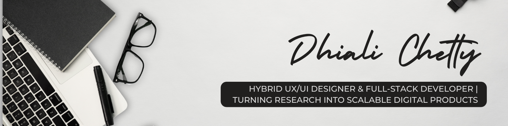

<!-- Header & Profile Section -->

# Welcome!

  
**DV300 Software Development Student** | **Final year projects**

## About Me

<!-- Short Biography -->
I’m a 21-year-old User Experience (UX) and Interactive Developer with a passion for creating intuitive and impactful digital experiences. My dual focus allows me to bridge the gap between design and functionality through user-centered design and creative coding. At Open Window Institute, I’ve gained practical skills in user research, wireframing, prototyping, front-end and back-end development and collaboration. I’m proficient in tools like Figma, HTML/CSS/JavaScript, Adobe Suite and GitHub. I’m driven to build digital solutions that are both innovative and user-focused.

## 🛠️ Technical Skills

### Programming Languages

### Web & Mobile Development

### Backend & Data

### Cloud, Tools & Design

## 2027 Main Projects

### Artifax

### Kenetic

### Zuri

---

## 📊 GitHub Statistics

## 📫 Let's Connect

I'm always open to discussing technology, collaboration opportunities or just having a friendly chat!

- **📧 Email:** (mailto:dhialichetty0@gmail.com)
- **🌐 Portfolio:** (https://dhiali.github.io/Dhiali-Portfolio-/)

---
